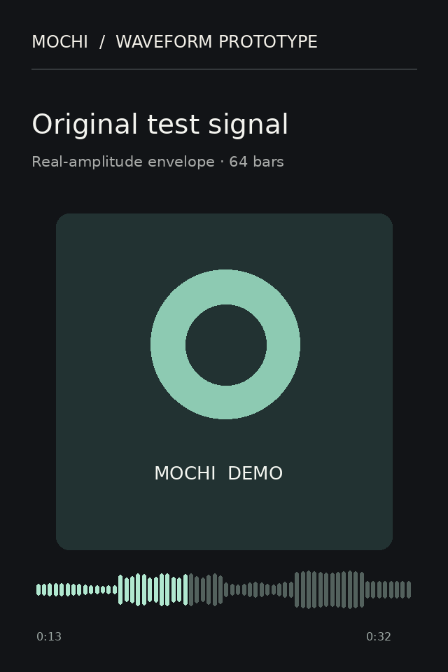

# Mochi OS 🎧

**An independent, community-oriented firmware project for the Shanling M1 Plus.**

> **Status: early development. No public firmware release is available yet.**
> Do not flash prototype files or publish `update.bin` built from an unverified tree.

## What makes it different?

Mochi OS is intended to be a complete alternative firmware distribution, **not a color theme for M1+ Music**. Its guiding idea is **music first**:

- **Now Playing as the home experience:** show the last song, its cover art and playback controls; no unintended auto-play on boot.
- **Real-audio waveform seek bar:** the bars reflect the actual intensity envelope of the song, and highlight playback progress. Currently a host prototype; not on-device yet.
- **Minimalist appearance:** a single flat background color, restrained accent themes and readable typography.
- **Powerful audio features:** preserve useful M1+ Music capabilities such as parametric EQ, AutoEQ, library and Cover Flow when compatible and tested.
- **Purposeful navigation:** avoid redundant pages and hide Pod Mode; remove old code only after dependencies are audited.
- **Custom boot and shutdown artwork:** reserved for the Mochi OS brand. Artwork has not been incorporated yet.

The project's interface, navigation, asset design and versioning are being developed independently. Its initial technical implementation builds on **official Shanling V2.1** and **[imfing's M1+ Music](https://github.com/imfing/m1plus-music)**. See [credits and licensing](docs/CREDITS.md).

## Waveform preview



*Development preview. The bars come from an original test signal with changing amplitude; this is not yet a device screenshot or user music.*

## Progress

| Area | Status |
|---|---|
| Standalone design mockups and AWTK resource prototype | Experimental; not integrated |
| Pure-C 64-bar waveform renderer | Prototype with automated tests |
| Waveform analysis from real WAV/FLAC audio on a computer | Working host-side prototype |
| On-device waveform computation, persistence and playback hook | Not implemented |
| Music-first launcher and last-session restoration | Planned |
| Native library, Cover Flow redesign, PEQ / AutoEQ integration | Planned |
| Public flashable firmware release | **Not available** |

## Getting started

- [Project architecture](docs/ARCHITECTURE.md)
- [Building and testing locally](docs/DEVELOPMENT.md)
- [Real-audio waveform design](docs/WAVEFORM.md)
- [Roadmap](docs/ROADMAP.md)
- [Contributing](CONTRIBUTING.md)
- [Safety and responsible testing](SECURITY.md)

For the host waveform proof of concept, with FFmpeg installed:

```bash
python3 tools/mochi_waveform.py "/path/to/track.flac" --out /tmp/mochi-waveform.json
python3 -m unittest discover -s test -p 'test_mochi_waveform.py' -v
```

The JSON is an *analysis artifact*, not a firmware update. No personal music files should be checked into the repository.

## Firmware, updates and safety

The project does **not** contain Shanling's proprietary firmware. Builders must supply permitted official inputs separately. The MIPS/AWTK integration and hard recovery must be validated before publishing any flashable image. An earlier local developer build booted on one unit, but that does **not** establish that Mochi OS is device-ready or safe for general installation.

**No public `update.bin` or one-click installation is offered at this stage.**

## License and attribution

The inherited code retains its existing MIT license and copyright notices, with third-party notices preserved. Mochi contributors' original code can be offered under the same license subject to review. See [docs/CREDITS.md](docs/CREDITS.md). Neither Shanling nor imfing officially endorses Mochi OS.
